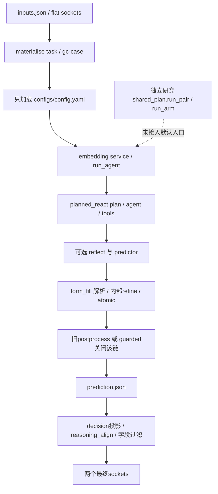

# P01-MECH-G0：机制清单、实际入口缺口与有限冒烟设计

[公开版省略逐例记录；汇总与机制结论保留。]

G0新增真实生成0、工具后端调用0、GPU计算0、训练0、服务操作0、下载/构建/上传/平台提交0。保留A01/C02/P01-PACK/GIT，复用既有报告和回执，不重做审计，不运行旧91例或C02验收批次。当前上传暂停，本报告仅本地存档；不改规划维护的CURRENT/INDEX或public pending。

## 交付及如何读状态

独立目录`output/p01_mechanism_acceptance_20261117/`：

- `mechanism_matrix.json` / `.md`：30项现有、历史、研究机制及4项后置意图；逐项记录意图出处、任务、源码/配置SHA、开关、触发、权限/成本、直接/最终消费者、正向/不触发/未知/错误证据与缺口。
- `entry_chain.json`：23处实际入口链定位及2处独立研究runner定位，带行号/文件SHA；`runtime_probe.json`记录实际导入模块文件及生效配置、编图和纯输出函数结果。
- `minimal_wiring_plan.json` / `.md`：7项规划决策门、条件式逐文件修改范围、测试与工时；没有实施。
- `fixture_manifest.json`、`fixtures/`、`finite_smoke_protocol.json` / `.md`：6个新写无患者/无GT夹具及精确文件SHA、G1测试前置和最多60次真实请求的G2草案；未执行。
- `registration.json`、Git状态/暂存快照、`preservation.json`、`local_manifest.json`、`handoff.json`：本地身份/保全和交接证据。

这些30项不是30项均批准提交，更不是同时优化30个方向。JSON中的final_submission_status=UNFROZEN；历史研究排除、当前default false、已有“保持关闭”决定和最终组合批准分别列明。G0只证明代码/配置/纯函数事实；实际新组合端到端证据缺失就写未验证，不能从旧研究或stub推定通过。

## 全部机制与既有意图

| 组 | 已纳入清单的机制 | 当前重要区分 |
|---|---|---|
| M01–M05 控制/模型 | 模型身份、请求/重试/上下文；输入适配；独立planner；ReAct；S4共享计划Fixed/Adaptive | 实际默认planned_react。S4有91对真实研究证据，但run_pair/run_arm未在实际入口分派；公平Direct ReAct只属后续参照准备 |
| M06–M11 信息/知识 | 临床MCP；InformationAccess预算/缓存/拒绝；影像工具；混合RAG/QA/重排；灰区强制RAG；C02 | 默认权限未开、影像随predictor启用；灰区强制RAG当前guard拒绝；C02仅T1两个载体/限定格式，工程通过不代表真实覆盖 |
| M12–M18 输入/预测 | 已观察特征装配；PSA日期/冲突；few-shot/kNN；图后预测器/成本掩码；预测器参考；T2/T3覆盖；T1 v2决策层 | 装配有历史生产保持关闭决定；旧研究排除不等于最终禁用。默认T3不做reveal成本掩码，其他部分按工具名计，需先统一合法成功可见性 |
| M19–M23 诊断/复核 | 外部reflect；内部结构化self-refine；原子核验；独立分歧/决策问题审核候选；填表/解析/默认恢复 | 两套Reflection开关和消费者不同；原子分解可能调用LLM；独立审核候选未接入生产且已要求不自动扩跑 |
| M24–M29 后处理/输出 | 数值free_text核验；T2治疗底线/WW例外；T3事件/时间/36月兜底/理由；权重置信度及reveal；reasoning_align；最终两sockets | 这些都可能覆盖/过滤上游。guarded formfill整体关闭旧postprocess；入口reasoning_align仍会覆盖T1/T2置信度和权重，不能当成同一个配置 |
| M30 可观察性 | 组件事件、请求/消费者/覆写绑定、临时目录清理和持久审计 | 逐例trace/receipt当前在临时output，未见清理前完整导出；少量cwd运行摘要不足作消费证明 |
| F01–F04 后置/未实现 | B01来源恢复、B02纵向理解、RL/节点策略/指南细标原子化/predictor扩维、公平Direct ReAct参照 | 后置不等于计划禁用。局部日期提取不等于完整纵向理解；atomic_fact_check不等于原子化检索 |

完整30项四类分支及消费者详见矩阵，不能仅用本分组表作验收通过清单。意图依据含AGENTS、当前总计划/C02终验、既有T1证据装配/复核结题报告、当前配置及历史关闭说明。没有最终profile冻结记录，执行端不从“最容易跑”配置倒推科学选择。

## 实际入口链与研究链分开

G0导入确认`inference.run_agent is chimera_agent_baseline.run.run_agent`，模块路径在本工作区，各SHA已记录。仅执行配置读取、无生成的graph编译及合成输出纯函数；没有调用inference.run、load_model、工具后端或任何服务。

实际默认链为：

主要定位：inference的`_materialise_case`、`_load_config`、`run`、`_decision_value`、`_reasoning_value`；run.py的`run_agent/_run_task_impl`；graph.py的`create_graph/_make_plan_node/_make_reflect_node`；form_fill.py的`form_fill/_run_self_refine`；postprocess.py的`apply_postprocessing`；reasoning_align.py的`align_reasoning`。精确行号/SHA见entry_chain，避免仅用当前Git HEAD代表脏工作区版本。

## 已确认的运行/消费缺口

| 断点 | G0证据等级与事实 | 对G1/G2的约束 |
|---|---|---|
| 配置未接入 | 实际_load_config三任务探针：workflow=planned_react、权限false、无shared_plan/C02。只手工合并旧overlay可通过配置检查，不是入口已加载 | 先有批准profile与首请求前的实际生效/拒绝验证 |
| 控制器不同 | 默认create_graph；S4独立run_arm含显式COMMON_DIAGNOSIS与关闭的旧审核/后处理 | 不靠加shared_plan配置冒充迁入，也不能移除guard限制就混合旧机制 |
| 权限与预测器冲突 | G0将默认只开guard，实际validate_options拒绝predictor/override | 最终逐任务predictor/影像/few-shot留否与合法输入先决；不能为了可跑静默关掉 |
| 外部Reflection丢失 | 编译包含reflect节点，但节点只返回refined_transcript；form_fill仍从messages取最后AI文本，没有读取该state字段 | 如批准保留，明确写回稿件/字段及证据约束，单独验证被读取和最终去向 |
| 两套Reflection | config.self_refine控制外部节点；graph内部另读CHIMERA_FORMFILL_SELF_REFINE开内部judgment纠正 | 不用一个true代表两套均触发；内部返回值可进入atomic/postprocess，外部目前无对应消费者 |
| 原子核验真实成本 | form_fill传model给atomic_fact_check，后者decompose_claims优先model.invoke，失败才regex | 不按“纯程序/无LLM”的注释记零成本；FALSE flags目前主要warning/置信度，不自动改诊断 |
| 填表重试低估 | 每个解析attempt可先prefill调用，异常后no-prefill再调用；3个attempt可产生6次wire调用 | 协议按实际wire尝试计，provider隐藏重试须0；不可只数外层循环 |
| 工具证据到填表 | agent可收到完整ToolMessage；form_fill主体用最后AI草稿作为transcript，并非直接完整临床原文 | 证据送达、诊断引用、后续填表使用分层；不能把模型自述作为一级患者事实已证实 |
| 后处理和最终覆盖 | 顺序为predictor覆盖→T1决策→数值→T2/T3规则→权重/置信度→最终align等。G0纯函数确认T1/T2 uncertain变clear、权重变常量、原prediction未变 | 原LLM/审核/后处理/最后sockets均需before/after；上游正向修改可能只保留在中间层，不以终分否定上游 |
| 精确上下文适配不足 | 当前LlamaContextGuard只支持system/human/ai；默认ReAct带ToolMessage与工具schema | G1要适配实际请求模板，不能删掉tool内容后假计数；无法精确验证就拒绝G2 |
| 日志生命周期 | inference的TemporaryDirectory覆盖逐例output，清理后再写两sockets；当前无完整审计导出点 | audit须在清理前保全，保留原两socket；cwd manifest不是逐机制消费回执 |
| 导入时环境常量 | T1决策层、权重/置信度等部分开关在form_fill import时解析 | 不在导入后设置env冒充生效；profile独立进程/显式依赖并记录解析值 |

本表不等于新增医学效果结论。没有反事实干预不能称某处丢弃导致某例错误；实际收到证据不等于模型按其推理，字段相同也可能是executed_no_delta。历史正向证据与本轮缺口分列，不重新调Prompt验证。

## 最小接线方案和规划门

必须先冻结D01控制架构、D02反思/核验组合与写回、D03预测器/few-shot/模态权限、D04逐任务RAG/C02来源与未知合同、D05后处理与最终字段权威、D06全部请求预算、D07审计保存。未明确的机制不自动禁用，guard也不自动放松。

逐文件修改建议仅为G1边界：inference/新增可信profile解析；run/graph的入口分派与证据绑定；若批准S4则新增单病例适配；若批准保留Reflection则修明确消费者；若保留predictor等则适配合法cache/模态；form_fill/postprocess/align只作批准的消费者/事件修复；新增统一wire预算/支持工具模板的上下文适配；必要测试和harness。完整文件列表、前置决策、范围及工时见minimal_wiring_plan，不在G0创建这些源文件。

常规profile/审计接线约2–4h；包含统一预算、反思消费和验收的原图兼容分支约6–10h。若选择S4迁入另估4–8h，若保留predictor权限适配另估4–8h。工作重叠不可简单相加；需要临床规则/Prompt/阈值、模型/权重或新科学机制变更时回规划，不算例行接线。

## G1/G2确切有限协议（只准备）

已冻结F01–F06六夹具：T1来源/条件正例、T1历史/未知、T1已确诊范围正常不触发、T1身份预检错误、T2真实入口、T3真实入口。无患者、无GT、无正确诊断标签；每文件SHA见fixture_manifest，工程expectation不进入agent输入。原C02/知识/源码身份只引用既有manifest，不搬正式资产或改其内容。

G1必须先做批准范围的纯函数/stub/真实MCP验收，生成0；确定性分支和G2自然触发分开。G2尚未授权：最多6夹具，F04应生成前失败为0调用，其余各≤12、总≤60真实wire请求，串行。先F04，再F01 pilot，核对后才执行余下。不能补第7例、重抽或调Prompt找正向。

复用既有35B/8765，seed20261117、temperature0.3/top_p0.95、reasoning预算1024、SDK retry0；每请求输出≤2048、输入≤14208、模板预留128、上下文16384；输出总预约≤122880、输入+输出总预约≤975360 token。逐阶段预算合计12，其中填表3是wire而非attempt，两套反思各至多2，atomic分解1。若现控制器只能输出budget_stop文本而无合格诊断，记失败，不冒充已诊断或增加免费请求。所有参数是待审的工程冒烟profile，不覆盖旧实验。

必须真实走inference与最终两个sockets；宿主harness只允许批准的路径常量覆盖，不替换model/tool/run_agent/决策函数。记录模型/源码/配置/模板/工具/输入/结果digest、usage/成本/时间以及审核/后处理/align每层去向；临时目录清理前保存私有审计，不新增平台socket。

缺必要自然触发即未验证，若纠正未发生只能证明no-issue路径。预测器/影像如批准保留但现六夹具无法覆盖，先回规划修订冻结，不能造向量或默默关闭。预算、身份、权限、使用量不明、资源冲突、在途超时或需要额外下载/构建立即停止保全。

按旧S4平均约10.4秒/调用只能粗估未来G2服务时间约10分钟，含CPU/上下文和恢复的墙钟提案20–60分钟，第一例后更新；不是现在部署或硬截止。完整准确条件、异常合同、资源和停止规则见finite_smoke_protocol，状态DRAFT_NOT_AUTHORIZED_NOT_EXECUTABLE。

## G0的完成和停止

本轮实际小探针仅：模块导入身份、三任务_load_config、无invoke编图、guard配置拒绝、三任务纯输出适配。model.invoke尝试0，未运行agent、工具、真实模型或服务，未运行大型测试/容器脚本。旧PACK/GIT已有结论保留，不重复做公开仓库/构建/权重检查。Mac总账仍未接收，不声称读过或重试SSH。

G0交付达到“供规划冻结”的范围；机制真实端到端总体NOT_READY，G1/G2 NOT_STARTED。用户暂停上传期间未做GitHub同步，当前仅本地版本证据；不声称新远端回读。CURRENT/INDEX由规划维护。本Goal在G0交付后结束，不自动接线、推理、打包、上传或平台操作。没有本轮后台任务需要等待。
